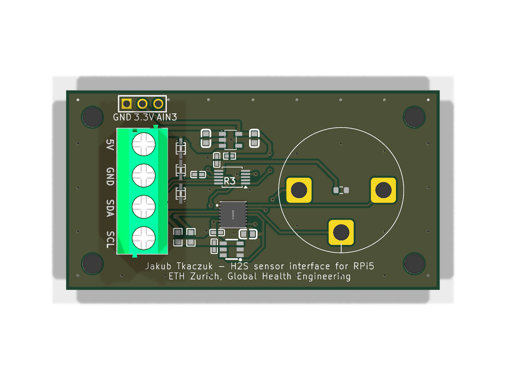

# H2S sensor board for Raspberry Pi

An open hardware board that measures hydrogen sulphide (H2S) from 0 to 1000 ppm, with a Python package and command-line tool that read it on a Raspberry Pi over I2C. It was built for biogas monitoring and works anywhere a Raspberry Pi needs a calibrated H2S reading.



## Features

- **Sensor:** Euro-Gas 4-H2S-1000 electrochemical cell (Honeywell CLE-0113-400), 0 to 1000 ppm, overload 2000 ppm.
- **Analog front end:** TI LMP91002 potentiostat with an external 2.5 V reference (ADR3425), so the zero point does not move with the supply.
- **ADC:** 16-bit ADS1115, about 0.2 ppm per step.
- **Temperature compensation:** an NTC thermistor sits under the cell and feeds the datasheet's temperature curves, or your own.
- **Wiring:** four wires to the Pi (5 V, GND, SDA, SCL) on a screw terminal.
- **Software:** a Python package (`h2s-reader`) with calibration files, CSV logging and averaging. Its tests run without hardware.

| | |
|---|---|
| Board size | 59.7 × 31.9 mm, four M3 holes (51.5 × 23.4 mm) |
| Supply | 5 V from the Raspberry Pi, 3.3 V regulated on board |
| I2C addresses | 0x48 (LMP91002), 0x49 (ADS1115) |
| Spare input | AIN3 of the ADS1115 on a 3-pin header (GND, 3.3 V, AIN3) |

## Quick start

1. **Build or order the board** with the files in [`hardware/`](hardware/README.md), and plug the 4-H2S-1000 cell into its sockets.
2. **Wire it to the Pi:**

   | Board (CN1) | Raspberry Pi header |
   |---|---|
   | 5V | pin 2 (5 V) |
   | GND | pin 6 (GND) |
   | SDA | pin 3 (GPIO 2, SDA) |
   | SCL | pin 5 (GPIO 3, SCL) |

3. **Enable I2C and install the package:**

   ```bash
   sudo raspi-config nonint do_i2c 0
   sudo apt install -y i2c-tools python3-venv
   i2cdetect -y 1                       # shows 48 and 49
   python3 -m venv ~/h2s && ~/h2s/bin/pip install "git+https://github.com/ghe-bomad/h2s-sensor-rpi#subdirectory=software"
   ~/h2s/bin/h2s-reader --selftest
   ~/h2s/bin/h2s-reader --stream
   ```

4. **Bring the board up** as described in [docs/bring-up.md](docs/bring-up.md).
5. **Calibrate the cell** with certified test gas ([docs/calibration.md](docs/calibration.md)). Until then readings can be up to ±44 % off, because cells differ that much.

## Documentation

| | |
|---|---|
| [hardware/README.md](hardware/README.md) | schematic, bill of materials, ordering, assembly, design checks |
| [software/README.md](software/README.md) | installing, command line, Python API, calibration file, tests |
| [docs/how-it-works.md](docs/how-it-works.md) | signal chain, range and resolution, temperature compensation |
| [docs/bring-up.md](docs/bring-up.md) | first power-up and checks, notes for use in biogas |
| [docs/calibration.md](docs/calibration.md) | zero, span and temperature calibration |
| [CHANGELOG.md](CHANGELOG.md) | changes per version |

## Repository layout

```
hardware/
  kicad/            KiCad 10 project and footprints
  production/       gerbers, BOM and positions for JLCPCB (H2S-RPi-V1)
  datasheets/       cell, LMP91002 and ADS1115 datasheets
  images/           board renders
  schematic.pdf     schematic export
  check.sh          ERC, DRC and exports with kicad-cli
software/
  h2s_reader/       Python package
  tests/            pytest suite (simulated I2C bus)
  calibration.example.toml
docs/               how it works, bring-up, calibration
```

## Status

- **Version:** 1 (H2S-RPi-V1).
- **Board design:** KiCad's ERC and DRC report only reviewed, non-critical items (see [hardware/README.md](hardware/README.md#design-checks)).
- **Software:** tested against a simulated I2C bus.
- **Not yet validated:** the response to certified H2S test gas. Calibration values are still to be measured.

## License

- **Hardware** (`hardware/`): [CERN-OHL-P-2.0](LICENSE-HARDWARE).
- **Software and documentation:** [MIT](LICENSE-SOFTWARE).
- **Datasheets:** belong to their manufacturers. See [LICENSE](LICENSE).

Developed at ETH Zurich, Global Health Engineering.
