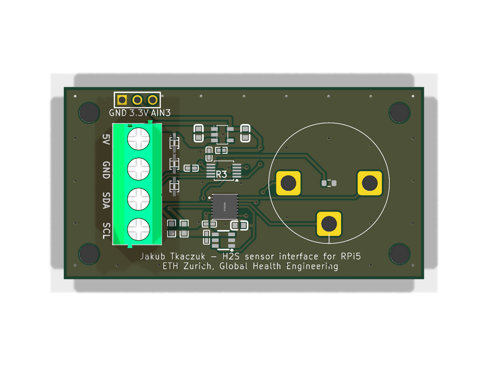
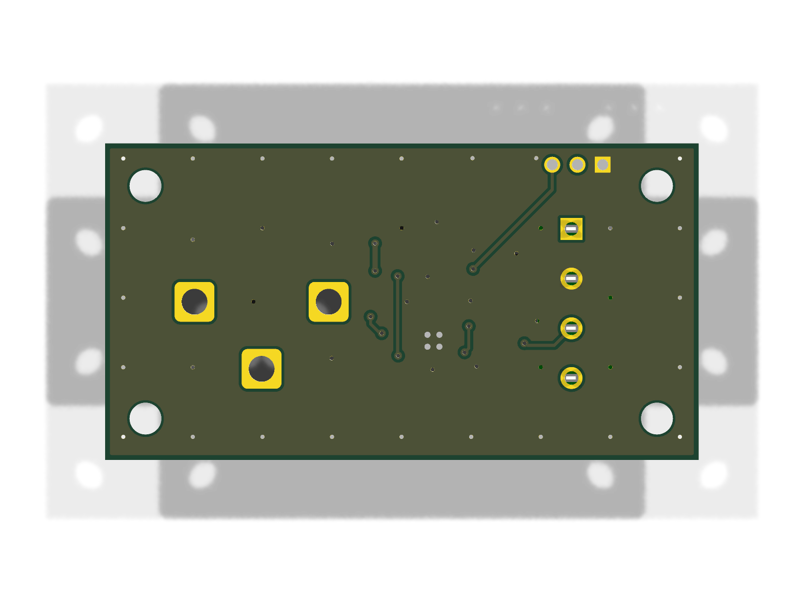

# Hardware

KiCad 10 project of the H2S sensor board, version H2S-RPi-V1. The full schematic is in [schematic.pdf](schematic.pdf).

| Top | Bottom |
|---|---|
|  |  |

## Circuit

| Ref | Part | Function |
|---|---|---|
| J5 | Euro-Gas 4-H2S-1000 cell (not in the BOM, order separately) | working (WE), counter (CE) and reference (RE) electrodes |
| U2 | LMP91002SDX | potentiostat: holds RE at the zero bias, converts the WE current to a voltage (7 kΩ internal gain) |
| U3 | ADR3425 | 2.5 V reference for the LMP91002 (`VREF`) |
| U7 | ADS1115IDGS | 16-bit ADC: AIN0 = LMP91002 output, AIN1 = GND, AIN2 = NTC divider, AIN3 = header H5 |
| TH1, R3 | NTC 10 kΩ (B 3950), 10 kΩ | temperature divider: 3.3 V, R3, AIN2, TH1, GND. TH1 sits under the cell |
| U1 | LP5907MFX-3.3 | 3.3 V regulator from the 5 V input |
| R1, R2 | 4.7 kΩ | I2C pull-ups to 3.3 V |
| E1 to E3 | RLSD32A051LC | bidirectional ESD protection on 5 V, SDA and SCL |
| CN1 | PA001-4P, 5.08 mm screw terminal | 5V, GND, SDA, SCL |
| H5 | 3-pin 2.54 mm header (not populated) | GND, 3.3V, AIN3 |

The LMP91002 enable pin (MENB) is tied to GND, so the chip is always on. The ADS1115 ADDR pin is tied to 3.3 V, which gives address 0x49. The LMP91002 has the fixed address 0x48.

## Connections

| CN1 | Signal | Raspberry Pi |
|---|---|---|
| 1 | 5V | pin 2 or 4 |
| 2 | GND | pin 6 |
| 3 | SDA | pin 3 (GPIO 2) |
| 4 | SCL | pin 5 (GPIO 3) |

The I2C lines are pulled up to 3.3 V on the board, which matches the Pi's logic level. Keep the cable short (under about 1 m at the default 100 kHz).

## Mechanical

- **Board:** 59.7 × 31.9 mm, 2 layers.
- **Mounting:** four M3 holes (3.2 mm), centres 51.5 × 23.4 mm apart.
- **Cell:** the 4-series cell is 20.2 mm in diameter and about 21 mm tall including its pins. The sensing face points away from the board.

## Bill of materials

The board can be assembled by JLCPCB with the files in [kicad/production/](kicad/production/). The LCSC numbers are in the BOM.

| Designator | Value | Package | LCSC |
|---|---|---|---|
| C1, C2, C6 | 1 µF | 0603 | C1592 |
| C3, C4, C5, C7 | 100 nF | 0402 | C1525 |
| CN1 | PA001-4P | 5.08 mm terminal | C173286 |
| E1, E2, E3 | RLSD32A051LC | SOD-323 | C20884 |
| R1, R2 | 4.7 kΩ | 0603 | C844460 |
| R3 | 10 kΩ | 0402 | C49330108 |
| TH1 | NTC 10 kΩ B3950 | 0603 | C7462093 |
| U1 | LP5907MFX-3.3 | SOT-23-5 | C23380874 |
| U2 | LMP91002SDX/NOPB | WSON-14 | C2651581 |
| U3 | ADR3425ARJZ-R7 | SOT-23-6 | C60864 |
| U7 | ADS1115IDGS | TSSOP-10 | C468683 |

Not in the BOM:

- **Cell:** Euro-Gas 4-H2S-1000, part number 2112B0113400. Datasheet in [datasheets/4-H2S-1000.pdf](datasheets/4-H2S-1000.pdf), shop link in [datasheets/sensor_url.txt](datasheets/sensor_url.txt).
- **Sockets for the cell's three pins:** pins are 1.5 mm in diameter; the board holes are 2.6 mm, sized for press-fit pin receptacles. The datasheet advises against soldering the cell or gluing it, because that voids the warranty and can damage it.
- **H5 header:** optional, only if you use AIN3.

## Ordering and assembly

1. **Upload** `kicad/production/H2S-RPi-V1.zip` (gerbers and drill files) to JLCPCB. Choose 2 layers and 1.6 mm thickness.
2. **For assembly,** add `H2S-RPi-V1_bom.csv` and `H2S-RPi-V1_positions.csv`. Check the part rotations in the assembly preview, especially U2, U3 and U7.
3. **Fit the cell sockets** by hand, then plug in the cell. The cell's WE pin is the one on its own, matching the footprint's pad 1.
4. **To regenerate the production files after a change,** use the KiCad plugin "Fabrication Toolkit" (settings in `kicad/fabrication-toolkit-options.json`).

## Editing the design

- **Symbols:** the schematic embeds them, so it opens on any KiCad 10 installation.
- **Footprints:** most come from LCSC via [easyeda2kicad](https://github.com/uPesy/easyeda2kicad.py). The two custom ones (cell, WSON-14) are in `kicad/H2S_Sensor.pretty`.
- **3D models:** they refer to `${EASYEDA2KICAD}`. Without that library the 3D view and the renders show the bare pads of those parts.

## Design checks

Run `hardware/check.sh` (needs `kicad-cli` from KiCad 10). It writes ERC and DRC reports to `hardware/reports/` and regenerates `schematic.pdf` and the renders. The current findings are reviewed and none of them needs a change:

| Check | Finding | Assessment |
|---|---|---|
| ERC | pins of type "Unspecified" connected to other pins (40) | symbols imported with easyeda2kicad have no pin types. Cosmetic |
| ERC | power input pins not driven (C1, C6) | no PWR_FLAG symbols on the 3.3 V and VREF nets. Cosmetic |
| ERC | input pin not driven: E3 pin 2, U7 AIN3 | E3 is an ESD diode; AIN3 goes to the optional header H5 |
| ERC | GND and MENB on the same net | intended: MENB is tied to GND |
| ERC | one unconnected wire end | a short leftover wire stub, no electrical effect |
| DRC | courtyards of TH1 and J5 overlap | intended: the NTC sits under the cell |
| DRC | silkscreen clipped by the solder mask at J5 | cosmetic |
| DRC | 4 pads of U2 without a schematic pin | the vias in the WSON-14 thermal pad, all GND |
| DRC | H5 "do not populate" differs between symbol and footprint | H5 is optional |
| DRC | missing field ALTIUM_VALUE (25) | leftover from the easyeda2kicad import |

## Ideas for a next revision

- **Filter capacitor:** add a footprint between the LMP91002 pins C1 and C2 (now unconnected) for hardware low-pass filtering of the amplifier output.
- **Power flags:** add PWR_FLAG symbols and pin types so ERC runs clean.
- **Test points:** add them for 3.3 V, VREF and the amplifier output.
